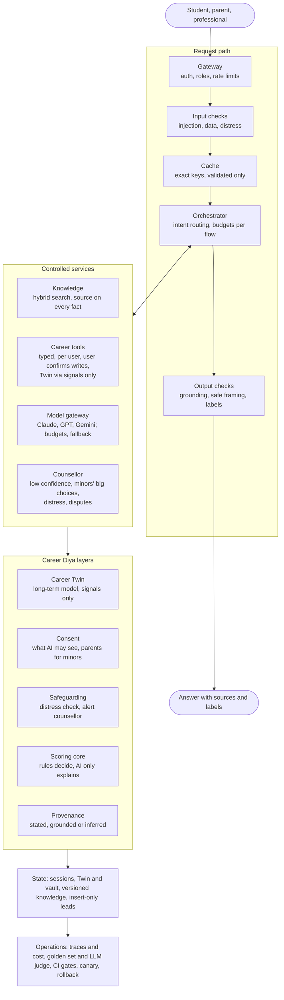
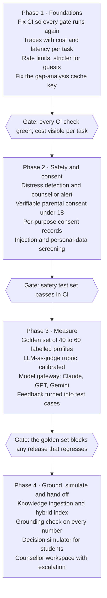

# ADR-CAREERDIY-0017 — Target AI Architecture (post-Kutumbh guidance)

## Status
**Proposed — pending sign-off.** This ADR sets the target architecture and the order of work after
Kutumbh 5.0 (21 November 2026). It changes no code, contract, migration or prompt by itself. Each
piece of work it calls for that touches a frozen area (OpenAPI contract, DB migrations, published
prompts, module boundaries) still needs its own ADR and governed amendment, per `CLAUDE.md`.

Living version (with diagrams that can be commented on):
[Career Diya — Target AI Architecture](https://claude.ai/artifact/E56qUxd1w1SB4Em6hqovQp).
If the two differ, this ADR is the record once accepted.

## Context
Career Diya has grown feature by feature (ADR-CAREERDIY-0005, 0013, 0015, 0016, ADR-CD-001), each with
a sound local decision, but with no single picture of where the AI system is heading. A standard
production AI-assistant reference architecture was reviewed on 13 November 2026 (online request path,
controlled execution, state and freshness, production operations). Most of it applies to Career Diya;
it lacks what career guidance specifically needs: a long-term model of the person, consent, minors and
guardians, safeguarding, provenance, a rule-based decision core and a counsellor workspace.

This ADR records the target that combines both, the gap from today's code, and the order in which
to close it. Current-state statements come from `feat/career-diya-career-vault` as of 13 November 2026.
Hosting and infrastructure settings were not reviewed.

## Decision

### Design principles
Eight principles decide every trade-off below. When a proposal conflicts with one, the principle wins
unless an ADR says otherwise.

1. **Deterministic core, AI at the edges.** Scores, rankings, eligibility and time estimates come from
   rules and data the team can inspect. The model explains, personalises and drafts; it never silently
   decides a recommendation.
2. **Every claim shows its source.** Each output carries a provenance label: from the user's own answers
   (stated), from verified data (grounded), or from the model (inferred). No number appears without a source.
3. **The counsellor stays at the centre.** The AI prepares, a human decides on anything high-stakes.
   Escalation to a counsellor is a designed path, not an afterthought.
4. **Minors first.** Design for a 15-year-old user with a parent in the room: consent, data minimisation
   and safe framing by default.
5. **Consent before context.** The model sees only the profile context the user has agreed to share, at
   the granularity they chose.
6. **The user model changes only through signals.** The long-term career model (the Twin) is never written
   directly; every change is a recorded signal with provenance (ADR-001).
7. **Measured before shipped.** No prompt, model or ranking change ships without passing the golden set
   and safety tests.
8. **Cheapest sufficient model.** Mock in tests, the smallest capable model in development, larger models
   only where evaluation shows they are needed.

### Architecture at a glance
Four layers: a request path every answer passes through, controlled services behind it, layers specific
to career guidance used by both, and shared state and operations underneath.

### Online request path
Every request passes the same five stages, in this order. Each stage can stop the request; none can be
skipped by a later one.

| Stage | Target behaviour for Career Diya | Taken from the reference |
| --- | --- | --- |
| 1. Gateway and identity | Supabase Auth with per-user Row Level Security on all user data. Rate limits per user and per IP, stricter for guest (anonymous) sessions. Roles: student, parent or guardian, professional, counsellor, admin. | Yes, plus roles |
| 2. Input guardrails | Prefer bounded inputs (choices, dropdowns) over free text. Free text is screened for prompt injection, for personal data the flow does not need, and for signs of distress. Age and consent state checked before any personal context is used. | Yes, plus distress and age checks |
| 3. Cache | Two caches with different rules. Public career-library answers may use a similarity cache. Personalised guidance uses only exact-key caches, keyed on prompt version, model and every input that changes the answer. Nothing is written to either cache until the output has passed validation. | Partly: no similarity cache for personal advice |
| 4. Router and orchestrator | Routes intent (explore, compare, plan, learn, book a counsellor) to a fixed workflow. Each workflow has a step limit, a time budget and a token budget. Free-form agent loops are not allowed for minors. | Yes, tighter for minors |
| 5. Output guardrails | Schema validation and repair; a grounding check that every number and named fact traces to a source; safe framing (no guarantees of admission, jobs or salary); provenance label attached; personal data the user did not share is stripped. Validation finishes before the answer is shown; low-risk explanatory text may stream after the structured result is validated. | Yes, plus provenance labels and a streaming rule |

A request that fails stage 2 or 5 gets a safe, specific refusal and, where relevant, an offer to talk to
a counsellor.

### Controlled execution
The orchestrator never reaches data, writes or models directly. It goes through four controlled
services, each with its own permissions and limits.

**Knowledge grounding (retrieval)**
- Sources: the career library, occupation and skills data (Lightcast or equivalent), job-posting trends,
  the Skill Diya course catalogue, admissions and entrance-exam rules, and Career Diya's own research summaries.
- Hybrid search (keyword plus vector) with re-ranking, filtered by audience (school, college, professional)
  and region (India first).
- Every retrieved passage keeps its source and as-of date, so the output guardrail can label it grounded.
- If the data is not retrieved, the answer does not state it: no invented salaries, growth rates or cut-offs.

**Career tools (controlled writes)**

| Tool | Writes to | Rule |
| --- | --- | --- |
| Save to Career Vault | User's vault | User confirms each save |
| Record a signal | The Twin, via `POST /twin/signals` only | Never a direct write (ADR-001) |
| Build or update a roadmap | Blueprint | User confirms; one active blueprint per goal |
| Book a counsellor | Lead record | Insert-only; user confirms contact details |
| Register course interest | Lead record | Insert-only; no enrolment implied |

Every tool has typed inputs, runs as the signed-in user under RLS, and is listed in the OpenAPI contract.
No tool uses the service-role key in a request path (invariant A5).

**Model gateway**
- One interface, several providers: Anthropic as primary, OpenAI and Google Gemini as configured
  alternatives, chosen per task by evaluation results, not by default.
- Per task: a model, a token budget, a timeout, retries with backoff, and a fallback model.
- Cost tiers kept (`AI_MODE`): mock in tests, the smallest capable model in development, larger models
  only where the golden set shows they are needed.
- Every call logs prompt version, model, tokens, latency and cost.

**Counsellor in the loop**
The AI hands a case to a certified counsellor when confidence is low or two directions are effectively
tied; the user is a minor and the decision is high-stakes (stream choice, dropping out, a costly course);
the user disagrees or asks for a person; or the safeguarding check fires. The hand-off carries a summary,
the user's consented context and the AI's reasoning.

### Layers specific to Career Diya

| Layer | What it does | Why career guidance needs it |
| --- | --- | --- |
| Long-term career model (the Twin) | Holds what is known about the person over time: interests, strengths, education, experience, goals, past explorations. Changes only through signals, each with source and date. | Guidance improves as the model learns the person; a session store that expires loses that. |
| Consent and context control | The user chooses what the model may see: all relevant context, only selected items, or "fresh eyes". Consent is recorded per purpose and can be withdrawn. | Required by India's DPDP Act 2023, and the basis of trust with parents. |
| Minors and guardian roles | Age captured at sign-up; under-18 users need verifiable parental consent where the law requires it. A linked parent account can see, but not overwrite, the student's results. | Most early users are school students; the family decides together. |
| Safeguarding | Free text and conversation are screened for signs of distress, self-harm or pressure. A positive check pauses the flow, shows support resources and alerts a counsellor. | Career pressure is a real stress point for Indian students; an AI must not carry on as normal. |
| Explainability and provenance | Every recommendation shows why and every fact shows its source (stated, grounded, inferred). Confidence is shown as bands, not false precision. | Families and counsellors must be able to check and challenge advice. |
| Decision simulator | Compares two or more options side by side: fit, skill gap, rough time at the user's weekly hours, cost, and one 30-day experiment. Runs on the deterministic core; the model only explains. | Lets students test a direction before committing years and money. |
| Counsellor workspace | A queue of escalated cases with summary and consented context; notes feed back as signals; outcomes feed evaluation. | Makes the human in the loop practical and turns counsellor judgement into test data. |

### State, data and freshness

| State | Holds | Lifetime | Refreshed by |
| --- | --- | --- | --- |
| Session | The current exploration or conversation | Hours; expires | The user's actions |
| Twin and vault | Long-term career model, saved careers, explorations, roadmaps | Until the user deletes it | Signals only (ADR-001) |
| Knowledge | Career library, occupations and skills, job trends, courses, admissions rules | Versioned; each record carries an as-of date | Scheduled ingestion: clean, chunk, embed, re-index |
| Leads and bookings | Counselling, admissions and course-interest requests | Per retention policy | Insert-only from the site; read only by staff |

- Re-ingesting a knowledge source refreshes the index and clears every cache entry built on the old version.
- Prompts, ranking rules, knowledge snapshots and models each carry a version; every stored answer records all four.
- Encryption at rest; secrets only in the environment or a secrets manager; personal data stripped from logs
  and traces; every staff read of personal data audited.
- A deletion request removes the user's Twin, vault, sessions and leads, and is logged without the deleted content.

### Evaluation and quality
No prompt, model, ranking rule or knowledge snapshot reaches users until it passes four layers. The golden
set is the release gate.

| Layer | What it checks | Built from | Runs |
| --- | --- | --- | --- |
| Golden set | The deterministic core ranks the expected directions for known profiles | 40 to 60 student, graduate and professional profiles, labelled by a certified career analyst | Every change, in CI |
| LLM-as-judge | Explanations are grounded, consistent with what the user said, free of invented numbers, and safely framed | A written rubric, calibrated against the analyst's own scores on a sample | Every prompt or model change |
| Safety tests | Injection attempts, distress signals, minors' data, guarantees of outcomes | A red-team set that grows with every incident | Every release |
| User and counsellor feedback | Real-world usefulness and disagreement | Thumbs up or down on results; counsellor notes on escalated cases | Weekly review |

Every bad answer found in feedback, a counsellor note or an incident becomes a new golden-set or safety
case. Providers are compared on the same set before any is chosen for a task. A regression blocks the release.

### Production operations
- **Observability:** a trace per request; p95 latency, tokens and cost per task and per user; alerts on
  error rate, cost spikes and safety triggers. Personal data never enters traces.
- **Reliability:** concurrency caps, queues for slow work, circuit breakers per model provider, and a
  deterministic fallback when every model is unavailable. Plan for peak concurrent users, not total users.
- **Release and recovery:** CI gates (governance, lint, typecheck, unit, golden set, safety) must be green;
  canary rollout for prompt and model changes; one-step rollback; tested backups.
- **Cost control:** a monthly AI budget with alerts at 50%, 80% and 100%; per-user daily limits, stricter
  for guest sessions.
- **Access toggles:** `CAREERDIYA_REQUIRE_LOGIN` and `CAREERDIYA_REQUIRE_PREMIUM` open features for demos
  and betas without changing feature logic. Turning login off requires guest rate limits and CAPTCHA first.

### Current state versus target (13 November 2026)
Career Diya meets roughly a quarter to a third of the target. It is strongest on data isolation and
controlled writes, and weakest on retrieval, evaluation and observability.

| Area | Today (code evidence) | Gap to target |
| --- | --- | --- |
| Controlled writes | Strong: contract-first API, RLS on every write, Twin changed only via signals, lead forms insert-only | Per-tool confirmation in any future agent flow |
| Gateway and identity | Mostly: Supabase Auth, API middleware checks, RLS tenant isolation proven | Rate limits; parent and counsellor roles |
| Consent and context | Partly: three context modes in Career Vault (all, selected, fresh eyes) | Per-purpose consent records; withdrawal; parental consent |
| Input guardrails | Partly: bounded dropdowns (ADR-CAREERDIY-0016), skill allow-list (`sanitizeCheckedSkills`), injection instruction in the guide prompt | Injection and personal-data screening; distress check |
| Output guardrails | Partly: schema validation and repair, off-topic direction screen, stated/inferred/grounded labels | Grounding check on every number; safe-framing check |
| Cache | Partly: exact-key caches keyed on prompt version and inputs | Gap-analysis cache key omits weekly hours; write only after validation |
| Deterministic core | Partly: rule-based scoring of 20 career directions, adjacency, course matching | Time estimates and 30-day experiments for the simulator |
| Model gateway | Partly: mock, Haiku and Sonnet tiers; model set by configuration | Second and third provider; fallback; per-task budgets |
| Knowledge grounding | Missing: career data in static files; Lightcast resources not wired in | Ingestion pipeline, hybrid index, as-of dates |
| Counsellor in the loop | Manual only: users can book a session | Automatic escalation and a counsellor workspace |
| Safeguarding | Missing | Distress detection and escalation path |
| Evaluation | Partly: 239 unit tests and engine regression harnesses | Golden set, LLM-as-judge, safety set, feedback loop |
| Observability | Missing: `packages/observability` is a placeholder | Traces, cost and latency metrics, alerts |
| Release | Weak: CI governance job failing at pnpm setup since at least September | Fix CI; canary and rollback for prompts and models |

### Roadmap after Kutumbh
Make the system observable and safe for minors first, then measurable, and only then add new AI
capability. Each phase ends at a gate that must pass before the next starts. Dates are not set yet.

## Consequences
- Future proposals are checked against the principles and the gap table before work starts; a proposal
  that skips a gate (for example new AI capability before the golden set exists) needs an explicit ADR.
- Most of the build touches frozen areas and will need its own ADRs:

| Change | Freeze it touches | Needs |
| --- | --- | --- |
| Consent records, parent links, counsellor cases, safeguarding events | Database schema | Migration + ADR |
| New tool endpoints (counsellor hand-off, simulator) | OpenAPI contract | Contract amendment + ADR |
| Grounded explanations, judge rubric prompts | Published prompts | New prompt version, never an in-place edit (ADR-003) |
| Model gateway, retrieval service, observability | Module structure | Boundary update in `scripts/check-module-boundaries.mjs` |

- Adding OpenAI and Gemini adds two vendors' data-processing terms to review before any user data is sent.

## Open decisions
- Which occupation and skills data source to license for India: Lightcast, O*NET with Indian mapping, or a mix.
- Vector store: Postgres `pgvector` inside Supabase, or a separate service.
- Who the escalation counsellors are, and what response time Career Diya can promise.
- Which method of verifiable parental consent fits the DPDP rules once they are final.
- Monthly AI budget, and the per-user daily limit for guests and signed-in users.
- Whether the decision simulator stays free for students or becomes part of a paid tier.
